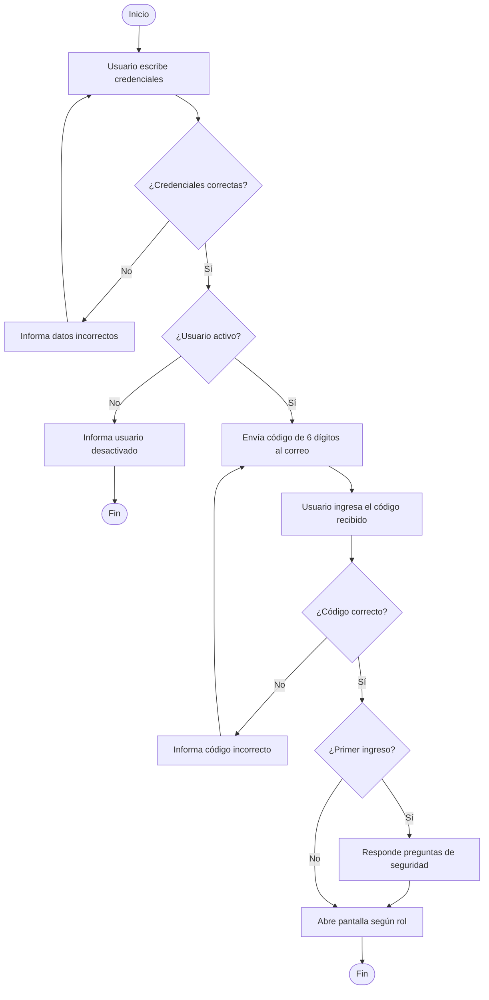

#  Sistema Épico — Gestión de Usuarios, Seguridad y Proveedores


**Sistema Épico** es una aplicación de escritorio desarrollada en **C# (Windows Forms)** con base de datos en **SQL Server** (`Sistema_Usuarios1`). El sistema está diseñado para la gestión empresarial centralizada de usuarios, roles, proveedores y políticas de seguridad, incorporando mecanismos robustos de autenticación como cifrado **SHA-256**, preguntas de seguridad y **verificación en dos pasos (2FA)** vía correo electrónico.

> **Contexto del Proyecto:** Desarrollado en el marco de las **Prácticas Profesionalizantes** y documentado como Trabajo Integrador de *Modelos y Sistemas* (7° año - E.E.S.T. N° 2).

---

##  Características Principales

* **Gestión de Usuarios y Roles:** Administración de cuentas (altas, bajas/desactivación, asignación de roles de *Administrador* o *Usuario General*).
* **Gestión de Proveedores:** Registro y organización de proveedores vinculados al sistema.
* **Políticas de Seguridad:** Configuración centralizada de reglas de acceso y requisitos de autenticación.
* **Seguridad Avanzada:**
  * Cifrado de credenciales mediante algoritmo **SHA-256**.
  * Autenticación en dos pasos (**2FA**) con envío de códigos dinámicos de 6 dígitos por correo electrónico.
  * Configuración obligatoria de **preguntas de seguridad** en el primer inicio de sesión.

---

##  Arquitectura del Software

El código fuente del proyecto está estructurado bajo una **arquitectura en 5 capas**, separando responsabilidades para facilitar el mantenimiento y la escalabilidad:

```text
SistemaEpico/
├──  CapaPresentacion   # Formularios e interfaces gráficas (Login, 2FA, Paneles, Políticas, Proveedores)
├──  CapaNegocio        # Lógica y reglas de negocio, validaciones, cifrado SHA-256 y envío de correos
├──  CapaDatos          # Conexión con SQL Server y ejecución de Procedimientos Almacenados
├──  CapaEntidades      # Clases modelo (Usuario, Persona, Proveedor, PoliticaSeguridad)
└──  BaseDeDatos        # Scripts SQL con la estructura de tablas y Stored Procedures (Sistema_Usuarios1)
```

---

##  Flujo de Inicio de Sesión (2FA)

El proceso de autenticación cuenta con tres controles de validación antes de conceder acceso al sistema:



### Guía Rápida de Acceso (Usuario Final)
1. Abrir **Sistema Épico** e ingresar **Nombre de usuario** y **Contraseña**.
2. Presionar **"Ingresar al sistema"**.
3. Revisar la bandeja de entrada del correo asociado (Asunto: *"Código de verificación"*) y copiar el código de 6 dígitos.
4. Pegar el código en la ventana **Verificación en dos pasos** (`frmCodigoContra`) y hacer clic en **"Aceptar"**.
5. *(Solo en el primer ingreso)* Completar las preguntas de seguridad para acceder al panel correspondiente según el rol.

---

##  Requisitos e Instalación

### Prerrequisitos
* **Sistema Operativo:** Windows 10 / 11.
* **IDE:** Visual Studio 2019 o superior (con carga de trabajo de desarrollo de escritorio de .NET).
* **Motor de Base de Datos:** Microsoft SQL Server (Express o Developer) y SQL Server Management Studio (SSMS).
* **Conexión a Internet:** Requerida para el envío de códigos de verificación SMTP.

### Pasos de Despliegue
1. **Clonar el repositorio:**
   ```bash
   git clone https://github.com/tu-usuario/sistema-epico.git
   ```
2. **Configurar la Base de Datos:**
   * Abrir SQL Server Management Studio (SSMS).
   * Ejecutar los scripts ubicados en la carpeta `/BaseDeDatos` para crear la base `Sistema_Usuarios1`, sus tablas y procedimientos almacenados.
3. **Configurar la Cadena de Conexión:**
   * Abrir la solución en Visual Studio.
   * Actualizar el *Connection String* en `CapaDatos` (o `App.config`) apuntando a tu instancia local de SQL Server.
4. **Compilar y Ejecutar:**
   * Presionar `F5` o hacer clic en **Iniciar** en Visual Studio.

---

##  Documentación Complementaria

El repositorio incluye documentación respaldatoria detallada:
* **Manual de Usuario:** Instructivo paso a paso con capturas anotadas y guía de resolución de errores comunes.
* **Manual Técnico y Análisis:** Especificación de Caso de Uso (`CU-01 Iniciar sesión`), flujos alternativos, excepciones y diagramas de proceso.

---

##  Autor

* **Nazareno Castaño Narvaez** — *Desarrollo y Documentación*
  * **Institución:** E.E.S.T. N° 2 (7° Año, 2ª División)
  * **Materia:** Modelos y Sistemas / Prácticas Profesionalizantes
  * 
